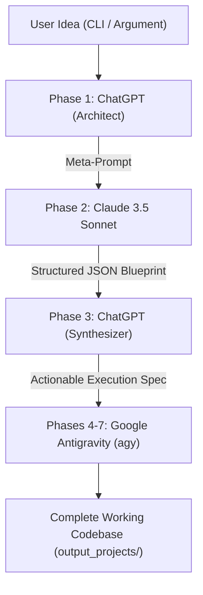

# 7-Phase Multi-Model Pipeline Orchestrator

An automated software engineering pipeline that transforms a single high-level software idea into a fully implemented codebase by orchestrating **ChatGPT**, **Claude 3.5 Sonnet**, and **Google Antigravity CLI (`agy`)**.

Instead of requiring paid API keys, the orchestrator connects directly to your authenticated Chrome browser session using Playwright and the Chrome DevTools Protocol (CDP).

---

## Architecture Overview



### The 7 Phases
* **Phase 1 (ChatGPT):** Acts as Chief Software Architect to analyze the idea and craft a structured, constraint-heavy meta-prompt tailored for Claude.
* **Phase 2 (Claude 3.5 Sonnet):** Consumes Phase 1's prompt and generates a strict, modular JSON blueprint (`system_overview`, `folder_structure`, `components`, `dependencies`, `data_flow`).
* **Phase 3 (ChatGPT):** Consumes Claude's architecture blueprint and compiles a concise, token-efficient, file-by-file execution prompt for Google Antigravity.
* **Phases 4–7 (Google Antigravity `agy`):** Autonomous agent creates the directory structure, writes the source code, runs setup and dependency installation, executes tests, and verifies the build.

---

## Installation

```bash
# Clone the repository
git clone <your-repo-url>
cd pipeline-orchestrator

# Install dependencies
pip install -r requirements.txt
```

---

## Session Persistence: One-Time Sign-in

> **Do you have to sign in every time?**  
> **No.** All sessions, cookies, and Cloudflare tokens are saved to the persistent profile directory (`~/.chrome-dev-profile`). As long as Chrome runs with this profile, you remain signed in across restarts.

### Starting the Chrome Session
Use the cross-platform Python starter:
```bash
python start_browser.py
```
*(On macOS/Linux you can also run `./start_browser.sh`).*

Once Chrome opens:
1. Ensure you are signed into [ChatGPT](https://chatgpt.com) and [Claude](https://claude.ai).
2. Leave the Chrome window open. You will not need to sign in again in future runs.

---

## Usage

### Run the Full 7-Phase Pipeline
```bash
python controller.py --idea "Build a CLI file manager in Rust"
```

### Inspect Prompts Only (Skip Antigravity Code Generation)
If you want to review the generated architecture blueprint and specification without triggering local code generation:
```bash
python controller.py --idea "Build a CLI file manager in Rust" --skip-antigravity
```

---

## Output Project Structure

All intermediate outputs and final projects are saved under `./output_projects/<project_slug>/`:

```text
output_projects/build_a_cli_file_manager_in_/
├── phase_1_prompt.txt     # Input sent to ChatGPT
├── phase_1_output.txt     # Meta-prompt produced by ChatGPT
├── phase_2_prompt.txt     # Input sent to Claude
├── phase_2_output.json    # Complete architecture blueprint from Claude
├── phase_3_prompt.txt     # Input sent to ChatGPT
├── phase_3_output.md      # Actionable Antigravity specification
└── [Project Source Code]  # Generated by Google Antigravity (Cargo.toml, src/, etc.)
```

---

## File Reference

* [controller.py](file:///Users/shrinkhals/Shrinkhal-Github/pipeline-orchestrator/controller.py): The main command-line entrypoint and phase orchestrator.
* [browser_driver.py](file:///Users/shrinkhals/Shrinkhal-Github/pipeline-orchestrator/browser_driver.py): Playwright browser automation driver connecting to Chrome on port 9222.
* [start_browser.py](file:///Users/shrinkhals/Shrinkhal-Github/pipeline-orchestrator/start_browser.py): Cross-platform script to launch Chrome with remote debugging enabled.
* [start_browser.sh](file:///Users/shrinkhals/Shrinkhal-Github/pipeline-orchestrator/start_browser.sh): Shell wrapper for macOS/Linux users.
* [login_setup.py](file:///Users/shrinkhals/Shrinkhal-Github/pipeline-orchestrator/login_setup.py): Quick launcher for first-time session authentication.
* [prompts.json](file:///Users/shrinkhals/Shrinkhal-Github/pipeline-orchestrator/prompts.json): The prompt templates for Phase 1, Phase 2, and Phase 3.
* [requirements.txt](file:///Users/shrinkhals/Shrinkhal-Github/pipeline-orchestrator/requirements.txt): Runtime dependencies (`playwright`).
