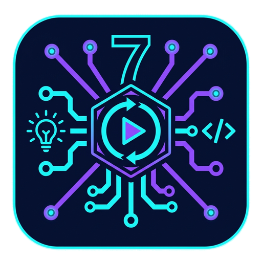
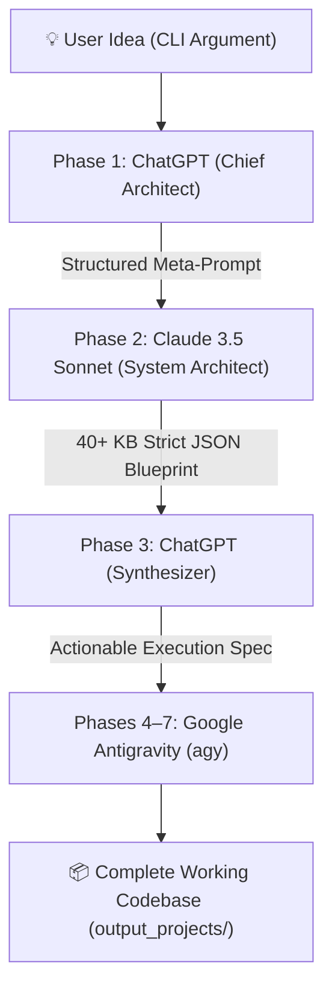

# 🚀 7-Phase Multi-Model Pipeline Orchestrator

<p align="center">
  
  <br>
  <em>Meet <strong>PIP-07 ("Octo-Pipeline")</strong> — The Autonomous 7-Phase Software Engineering Pipeline Orchestrator.</em>
</p>

An autonomous software engineering pipeline that transforms a single high-level idea into a fully implemented, compiling, and tested codebase by orchestrating **ChatGPT**, **Claude 3.5 Sonnet**, and the **Google Antigravity CLI (`agy`)**.

Instead of requiring paid API keys, the orchestrator connects directly to your authenticated Chrome browser session via Playwright using the Chrome DevTools Protocol (CDP).

---

## 🏗️ Architecture Overview



### The 7 Phases

| Phase | Model / Tool | Role & Responsibility |
| :--- | :--- | :--- |
| **Phase 1** | **ChatGPT** | **Chief Software Architect**: Analyzes the raw idea and crafts a structured, constraint-heavy meta-prompt tailored specifically for Claude. |
| **Phase 2** | **Claude 3.5 Sonnet** | **System Architect**: Generates a strict, modular JSON blueprint containing `system_overview`, `folder_structure`, `components`, `dependencies`, and `data_flow`. |
| **Phase 3** | **ChatGPT** | **Synthesizer / Spec Writer**: Compiles Claude's architecture blueprint into a token-efficient, file-by-file execution prompt for Google Antigravity. |
| **Phases 4–7** | **Google Antigravity (`agy`)** | **Autonomous Implementer & Verifier**: Scaffolds directories, writes complete production source code, installs dependencies, runs test suites, and verifies the build. |

---

## 📦 Installation

Clone the repository and install runtime dependencies:

```bash
# Clone the repository
git clone <your-repo-url>
cd pipeline-orchestrator

# Install dependencies
pip install -r requirements.txt
```

---

## ⚡ How to Run the Pipeline (3 Steps)

Follow these three straightforward steps to run the pipeline:

### Step 1: Start Chrome with Remote Debugging
Launch Google Chrome with remote debugging on port `9222` using the cross-platform starter:

```bash
python3 scripts/start_browser.py
```
*(On macOS/Linux, you can also run `./scripts/start_browser.sh`).*

This automatically starts Chrome with a dedicated, persistent profile directory (`~/.chrome-dev-profile`).

---

### Step 2: Sign In Once
In the Chrome window that just opened:
1. Navigate to **[ChatGPT](https://chatgpt.com)** and verify you are logged in.
2. Navigate to **[Claude](https://claude.ai)** and verify you are logged in.
3. Keep the browser window open.

> **Session Persistence**: All cookies, session tokens, and Cloudflare authorizations are saved to `~/.chrome-dev-profile`. You will **not** need to sign in again on future runs.

---

### Step 3: Run the Orchestrator
Trigger the pipeline with your project idea:

#### Full 7-Phase Run (Blueprint + Code Generation)
```bash
python3 controller.py --idea "Build a CLI file manager in Rust"
# Alternatively via module:
python3 -m orchestrator --idea "Build a CLI file manager in Rust"
```

#### Blueprint & Spec Review Only (Skip Antigravity Code Generation)
If you want to review the generated architecture blueprint and specification without triggering local code generation:
```bash
python3 controller.py --idea "Build a CLI file manager in Rust" --skip-antigravity
```

---

## 📂 Modular Repository Structure

The codebase is organized into self-documenting, modular folders where each folder's name describes its files' work, and each folder contains a dedicated `README.md` explaining its contents:

```text
pipeline-orchestrator/
├── assets/                       # 🎨 Project branding & logo icons
│   └── pip07_icon.png            # 128x128 PIP-07 Octo-Pipeline logo
├── Octo-Pipeline.jpg             # Project banner & pipeline symbol
├── controller.py                 # Primary CLI entrypoint (delegates to orchestrator)
├── requirements.txt              # Project dependencies (playwright)
│
├── prompts/                      # 📝 Prompt templates and model specifications
│   ├── README.md                 # Explains prompt files & template variables
│   └── prompts.json              # Phase 1, Phase 2, Phase 3 prompt templates
│
├── scripts/                      # 🛠️ Standalone utility & setup scripts
│   ├── README.md                 # Explains setup scripts and parameters
│   ├── start_browser.py          # Cross-platform Chrome CDP launcher
│   ├── start_browser.sh          # macOS/Linux shell starter
│   └── login_setup.py            # Guided first-time login setup
│
├── orchestrator/                 # 📦 Core pipeline Python package
│   ├── README.md                 # Explains orchestrator package architecture
│   ├── __init__.py               # Package exports and version metadata
│   ├── __main__.py               # Package CLI entrypoint (python -m orchestrator)
│   │
│   ├── config/                   # ⚙️ Configuration constants & prompt loading
│   │   ├── README.md             # Explains config settings and loaders
│   │   ├── settings.py           # Ports, profile dir, paths, and timeouts
│   │   └── prompt_loader.py      # Prompt template loader
│   │
│   ├── browser/                  # 🌐 Browser automation subsystem (CDP)
│   │   ├── README.md             # Explains launcher, CDP connection & model drivers
│   │   ├── launcher.py           # Chrome detection & process management
│   │   ├── connection.py         # Playwright CDP connection handling
│   │   ├── chatgpt.py            # ChatGPT prompt dispatch & stream scraper
│   │   └── claude.py             # Claude prompt dispatch & stream scraper
│   │
│   ├── execution/                # ⚡ Local code generation runner
│   │   ├── README.md             # Explains Antigravity CLI runner
│   │   └── antigravity.py        # Antigravity CLI (agy) detection and execution
│   │
│   └── pipeline/                 # 🔄 7-phase coordinator engine
│       ├── README.md             # Explains pipeline phases and artifact flow
│       └── runner.py             # Pipeline runner sequencing Phases 1 through 7
│
└── output_projects/              # 📂 Generated projects and intermediate artifacts
    └── README.md                 # Explains artifact formats and directory layouts
```

---

## 🔍 Verified Example: Rust File Manager (`rfm`)

The pipeline has been verified on a complex systems engineering task:
`"Build a CLI file manager in Rust"`.

The pipeline successfully executed all phases:
1. **Phase 1**: Produced a structured meta-prompt establishing hexagonal architecture constraints.
2. **Phase 2**: Claude generated a 46 KB JSON architecture detailing Domain, Application, Presentation, and Infrastructure layers.
3. **Phase 3**: ChatGPT assembled a 1,266-line implementation specification.
4. **Phases 4–7**: Google Antigravity constructed the crate [`rfm`](output_projects/build_a_cli_file_manager_in_ru/rfm):
   * **Compilation**: `cargo check` built successfully with 0 errors.
   * **Unit Tests**: `cargo test` ran and passed all tests:
     ```text
     running 3 tests
     test domain::tests::test_entry_kind_display ... ok
     test domain::tests::test_root_deletion_protection ... ok
     test domain::tests::test_copy_into_self_detection ... ok
     test result: ok. 3 passed; 0 failed; 0 ignored
     ```
   * **CLI Execution**: Subcommands (`rfm ls`, `rfm stat`, `rfm mkdir`, `rfm cp`, `rfm mv`, `rfm rm`, `rfm repl`) operate seamlessly.

---

## ⚙️ Advanced CLI Options

You can customize execution with optional flags:

```bash
python3 controller.py --help

options:
  -h, --help            Show this help message and exit
  --idea IDEA           High-level project idea description to design and generate
  --skip-antigravity    Skip Phases 4-7 (stops after producing Phase 3 architecture spec)
  --auto-approve        Bypass interactive permission checks during Antigravity execution (uses --dangerously-skip-permissions)
  --output-dir DIR      Custom output directory (default: ./output_projects)
  --prompts FILE        Custom prompts.json file path
```

---

## 🛡️ Security & Privacy Architecture

This project is built with defensive defaults to protect your machine, browser sessions, and intellectual property:

### 1. Restricted Chrome DevTools Protocol (CDP) Origins
* **Origin Isolation**: The browser launcher restricts allowed CDP origins to `http://127.0.0.1:9222` and `http://localhost:9222` instead of using wildcards (`*`). This prevents external or malicious web pages from initiating unauthorized WebSocket connections to your debugging port.
* **Dedicated Browser Instance**: Always keep the automated Chrome instance strictly dedicated to ChatGPT and Claude. Do not use this window for everyday browsing, banking, or email.

### 2. Hardened Profile Permissions (`0700`)
* The persistent profile directory (`~/.chrome-dev-profile`) stores session cookies and Cloudflare tokens. On Unix/macOS, it is automatically created and restricted to permission mode `0700` (`rwx------`), preventing other local user accounts from reading your session data.

### 3. Safe Execution by Default (Human-in-the-Loop)
* Google Antigravity CLI (`agy`) runs in **safe mode with interactive confirmations enabled** by default. Commands and disk modifications require approval before execution.
* If you are running a completely trusted idea in an isolated sandbox, you can opt into autonomous execution with `--auto-approve`.

### 4. LLM Data Privacy & Training Disclosures
* The pipeline transmits project ideas, specifications, and architecture blueprints to **OpenAI (ChatGPT)** and **Anthropic (Claude)**.
* If you are developing proprietary or confidential software, disable model training in your accounts:
  * **ChatGPT**: *Settings* ➔ *Data Controls* ➔ Disable *Chat history & training*.
  * **Claude**: *Settings* ➔ *Privacy* ➔ Ensure data training opt-out is enabled.


---

## 🛠️ Troubleshooting

### 1. `Could not connect to Chrome on port 9222`
Ensure Chrome was started with the debug flag:
```bash
python3 scripts/start_browser.py
```
If Chrome is already open from an everyday session, close it and run `python3 scripts/start_browser.py` (or `./scripts/start_browser.sh`) so Chrome starts with `--remote-debugging-port=9222`.

### 2. Cloudflare or Bot Challenge
If ChatGPT or Claude displays a "Verify you are human" challenge:
Simply complete the checkbox in the opened Chrome window. Because the profile directory is persistent (`~/.chrome-dev-profile`), the clearance token is remembered for subsequent runs.

### 3. `'agy' command not found`
Ensure Google Antigravity CLI (`agy`) is installed and available in your `PATH` or in `~/.local/bin/agy`.
If you only want to generate prompts and blueprints without running the local agent, pass `--skip-antigravity`.
