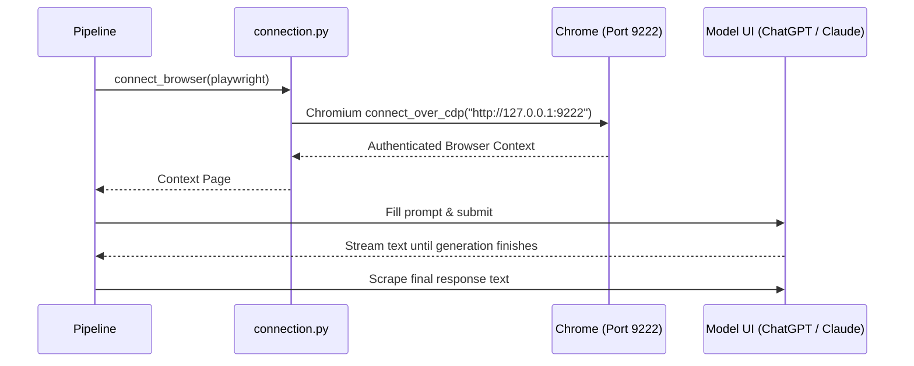

# 🌐 Browser Automation Module (`orchestrator/browser/`)

This module controls the Chrome browser using the Chrome DevTools Protocol (CDP) and Playwright. It automates model interaction in your existing authenticated web sessions without requiring API keys.

---

## 📄 Files in this Folder

| File | Purpose | Key Functions |
| :--- | :--- | :--- |
| **[`launcher.py`](launcher.py)** | Cross-platform Chrome discovery and process lifecycle management. | `launch_chrome()`, `find_chrome()`, `is_port_listening()` |
| **[`connection.py`](connection.py)** | Connects Playwright over CDP to the Chrome remote debugging port. | `connect_browser()` |
| **[`chatgpt.py`](chatgpt.py)** | Automates ChatGPT web UI: navigates, enters prompt, monitors stream, extracts answer. | `run_chatgpt_prompt()` |
| **[`claude.py`](claude.py)** | Automates Claude web UI: navigates, enters prompt, monitors stream, extracts answer. | `run_claude_prompt()` |
| **[`__init__.py`](__init__.py)** | Clean module re-exports. | All of the above |

---

## 🔍 How this Module Works

1. **Persistent Authentication**: By connecting to `--user-data-dir="~/.chrome-dev-profile"`, all logins, cookies, and Cloudflare challenges remain solved.
2. **Streaming Detection**: Each model client detects streaming start via Stop button appearance and streaming completion via button disappearance or DOM length stabilization.
3. **Resilience**: Features automatic retries on navigation failures and fallback scrapers for DOM variations.
